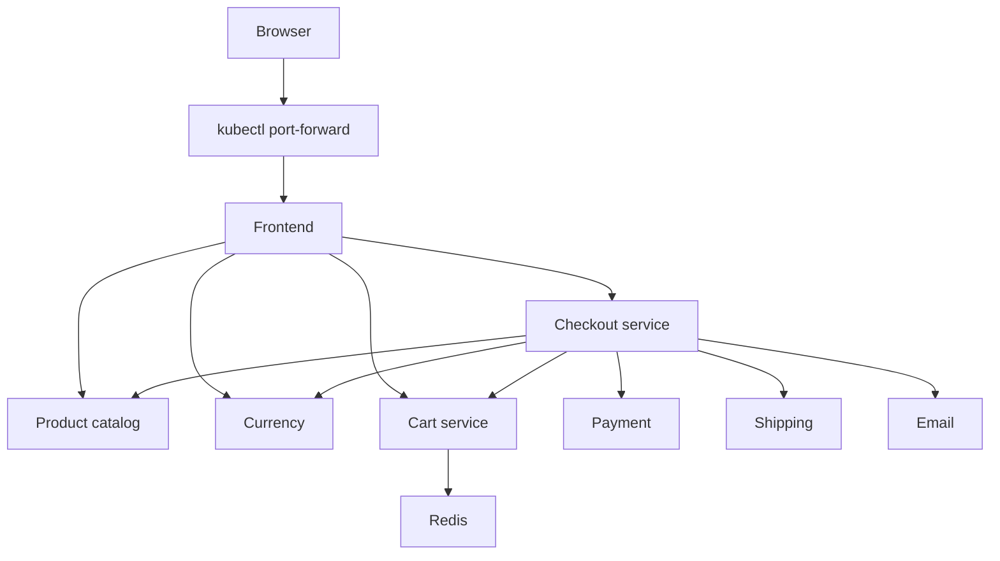

# Architettura e scelte tecniche

## Obiettivo

Eseguire Online Boutique in un laboratorio Kubernetes locale con:
- ambienti dev e prod separati tramite namespace;
- frontend personalizzato e immagini associate a revisioni Git;
- procedure automatizzate di validazione, build e deploy;
- verifiche applicative, metriche e prova documentata di rollback;
- autenticazione Redis con credenziali generate fuori dal repository.

Il progetto deriva da GoogleCloudPlatform/microservices-demo.
Le modifiche della challenge sono concentrate in platform/, nel frontend
e nel workflow .github/workflows/kiratech-ci.yaml.

## Componenti applicativi

Il frontend espone l'interfaccia HTTP e comunica con i servizi applicativi
tramite gRPC. Il diagramma mostra i principali flussi del percorso di acquisto;
non rappresenta tutte le chiamate fra i microservizi.

Completano l'applicazione adservice e recommendationservice.
Il loadgenerator produce traffico di prova nell'ambiente dev.

I servizi di pagamento e spedizione appartengono all'applicazione demo:
il checkout non corrisponde a un acquisto reale.

## Topologia del laboratorio

Un cluster kind a singolo nodo ospita entrambi gli ambienti.

| Proprietà | Dev | Prod |
| --- | --- | --- |
| Namespace | boutique-dev | boutique-prod |
| Repliche frontend | 1 | 2 |
| Repliche loadgenerator | 1 | 0 |
| Accesso locale | localhost:8082 | localhost:8081 |
| Secret Redis | redis-auth nel namespace dev | redis-auth nel namespace prod |

Ogni ambiente dispone delle proprie risorse applicative e del proprio Redis.
I riferimenti ai servizi, come redis-cart:6379, vengono risolti nel namespace
del chiamante.

I namespace separano nomi e configurazioni. Non costituiscono da soli
isolamento di rete: non è stata verificata una policy che impedisca il
traffico fra dev e prod.

Entrambi gli ambienti condividono nodo, risorse e dominio di guasto.
Due repliche frontend in prod non garantiscono disponibilità in caso
di perdita dell'unico nodo.

## Scelte di piattaforma

### kind

Consente di utilizzare Kubernetes localmente con nodi containerizzati,
adatto a un laboratorio su Ubuntu/WSL2 senza infrastruttura cloud dedicata.

Il setup fissa l'immagine del nodo tramite versione e digest.
L'accesso applicativo avviene tramite port-forward.

### Kustomize

Una base comune contiene i manifest applicativi.
Gli overlay definiscono namespace, etichette, repliche, immagine frontend
e patch specifiche dei due ambienti.

La scelta permette di condividere la base e rendere esplicite le differenze
fra dev e prod senza introdurre un chart dedicato.

Le patch Redis sono attualmente presenti in entrambi gli overlay:
una futura estrazione in un componente comune ridurrebbe la duplicazione.

### Immagini frontend associate a Git

Gli overlay indicano un tag nella forma kiratech-frontend:git-<12 caratteri>.

Lo script build-frontend.sh:
- risolve la revisione Git richiesta;
- costruisce il frontend dai sorgenti archiviati di quella revisione;
- aggiunge la label org.opencontainers.image.revision;
- verifica la label prima di riutilizzare un'immagine locale esistente.

setup.sh carica le immagini in kind prima del deploy.

Il tag permette di risalire ai sorgenti. Non garantisce da solo
riproducibilità byte per byte: alcune immagini base non sono fissate
tramite digest.

Gli altri microservizi usano immagini upstream. I loro binari non vengono
ricostruiti dalla CI della challenge: la versione dei sorgenti nel fork
può quindi differire da quella contenuta nelle immagini rilasciate.

## Automazione e CI

| Elemento | Responsabilità |
| --- | --- |
| validate.sh | Generazione dei manifest Kustomize dev/prod |
| build-frontend.sh | Build o riutilizzo controllato del frontend |
| init-redis-secret.py | Creazione del Secret Redis se assente |
| deploy.sh | Namespace, Secret, validazione server, apply e rollout |
| setup.sh | Preparazione immagini, cluster e deploy degli ambienti |
| kiratech-ci.yaml | Sintassi shell, rendering, test Go e build frontend |

La validazione Kustomize verifica la generazione dei manifest.
La validazione server viene eseguita da deploy.sh contro il cluster.

La CI non effettua il deploy nel cluster locale e non esegue test
end-to-end dell'intero negozio.

## Sicurezza applicata

Il frontend usa un ServiceAccount dedicato e disabilita il montaggio
automatico del token del ServiceAccount.

La configurazione include:
- esecuzione non-root;
- filesystem root in sola lettura;
- rimozione delle capability Linux;
- privilege escalation disabilitata;
- profilo seccomp RuntimeDefault;
- richieste e limiti di CPU e memoria.

Queste impostazioni non equivalgono a un audit completo della sicurezza
di tutti i componenti del cluster.

Redis richiede autenticazione. Le credenziali vengono generate al setup
e conservate in un Secret Kubernetes separato per ambiente.
Cartservice riceve la stringa di connessione tramite secretKeyRef.

Le probe Redis verificano una risposta PONG usando autenticazione.
Il setup conserva i Secret già presenti e non implementa rotazione.

L'uso di un Secret Kubernetes non dimostra cifratura a riposo.
Nel laboratorio non è stato configurato TLS per il collegamento Redis.

## Dati e disponibilità

Redis usa un volume emptyDir: i dati sono legati alla vita del pod.
La sostituzione del pod può perdere i carrelli.

Il Deployment Redis usa la strategia Recreate per evitare sovrapposizione
di istanze con archivi temporanei indipendenti durante un aggiornamento.
Questo comporta un intervallo di indisponibilità durante la sostituzione.

Il laboratorio non implementa persistenza, replica Redis o backup.
Queste sono limitazioni esplicite, non caratteristiche di una piattaforma
pronta per produzione.

## Osservabilità

Il frontend produce log JSON con identificativo richiesta, percorso,
metodo, codice HTTP e durata.

Le probe HTTP verificano l'endpoint /_healthz.
Non dimostrano da sole il funzionamento del checkout completo.

L'endpoint /metrics espone frontend_http_requests_total:
- conta le richieste completate dal processo;
- esclude /_healthz e /metrics;
- riparte da zero al riavvio;
- non aggrega automaticamente le repliche.

Non è stato configurato un collector centralizzato di metriche o log.
La verifica funzionale comprende navigazione, carrello, valuta e checkout.

## Ripristino e verifiche

È stata eseguita una prova controllata di immagine frontend non disponibile
in dev, seguita da rollback a una revisione funzionante e verifica HTTP.

Il dettaglio è disponibile in
[incident-image-pull.md](incident-image-pull.md).

Il setup è stato eseguito sul cluster esistente e su un nuovo cluster
kind dedicato. La seconda prova ha riutilizzato l'immagine frontend
locale e richiesto un intervento sui limiti inotify dell'host.
Dev e prod hanno superato le verifiche HTTP e i checkout manuali.
Dettagli e limiti: [verifica di ricostruzione](rebuild-verification.md).

Per i comandi operativi consultare [quickstart.md](quickstart.md).
