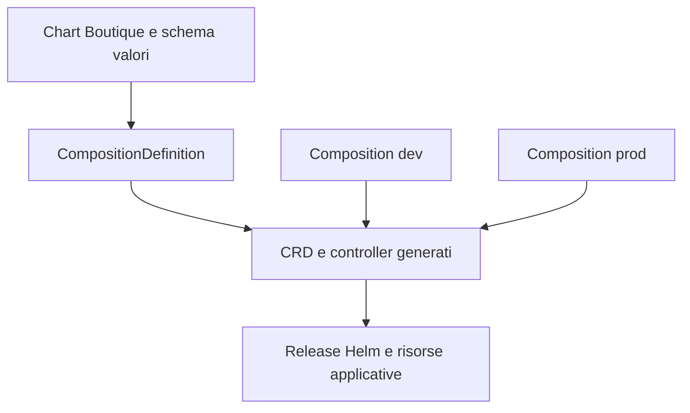

# Valutazione Krateo PlatformOps

## Stato e decisione

Questo documento è una valutazione progettuale.
Krateo non è installato nel laboratorio e l'integrazione descritta
non è stata eseguita né verificata.

Per la consegna attuale viene mantenuto il percorso operativo
GitHub Actions + Kustomize + script + kind.

Una possibile evoluzione è offrire Online Boutique come servizio
standardizzato, istanziabile attraverso Krateo.

## Meccanismo rilevante

Secondo la documentazione ufficiale del Core Provider:

- una CompositionDefinition registra un chart Helm;
- il Core Provider genera una CRD e il relativo controller dinamico;
- una Composition rappresenta un'istanza del servizio;
- il Composition Dynamic Controller gestisce la release Helm;
- il chart deve includere values.schema.json per descrivere e validare
  i valori esposti dalla risorsa generata.

Questa valutazione riguarda tale percorso basato su Helm.
Non assume che gli overlay Kustomize attuali siano direttamente
utilizzabili come CompositionDefinition.

## Proposta per Online Boutique

L'obiettivo sarebbe permettere a un operatore di richiedere un ambiente
Online Boutique mediante un insieme limitato di parametri approvati.

Il seguente è un flusso progettuale, non una configurazione eseguibile.

La separazione fra dev e prod rimarrebbe esplicita.
Il comportamento dei namespace e delle autorizzazioni andrebbe verificato
sulla versione Krateo selezionata prima di implementare il prototipo.

## Parametri proposti

Questi nomi rappresentano il contratto del chart da progettare,
non campi già presenti nel repository.

| Parametro | Finalità | Vincolo proposto |
| --- | --- | --- |
| environment | Selezione ambiente | dev oppure prod |
| frontend.image | Immagine frontend | Riferimento approvato, preferibilmente digest |
| frontend.replicas | Numero repliche | Intero con limiti definiti |
| loadgenerator.enabled | Traffico sintetico | Disabilitato per il profilo prod |
| redis.existingSecret | Secret da utilizzare | Nome di un Secret già predisposto |
| resources | Richieste e limiti | Valori validati e coerenti con il cluster |

Password e token non dovrebbero essere inseriti nei valori della Composition.
Il chart dovrebbe utilizzare riferimenti a Secret predisposti separatamente.

Per evitare configurazioni incoerenti, il profilo prod dovrebbe imporre
i vincoli previsti dal progetto mediante schema e controlli del chart.

## Modifiche necessarie

1. Selezionare una versione Krateo e verificarne requisiti e compatibilità
   con il cluster di prova.
2. Preparare un chart dedicato alla configurazione della challenge,
   oppure adattare il chart upstream dopo averne verificato il contenuto.
3. Trasferire nel chart le personalizzazioni oggi presenti in Kustomize:
   immagine frontend, repliche, sicurezza e autenticazione Redis.
4. Definire values.schema.json e testare i valori ammessi.
5. Pubblicare e versionare il chart in un repository raggiungibile.
6. Rendere le immagini frontend disponibili ai nodi di destinazione.
   Per un ambiente condiviso sarebbe opportuno un registry accessibile,
   al posto del caricamento locale con kind load.
7. Predisporre i Secret nei namespace di destinazione.
8. Registrare la CompositionDefinition e creare le istanze dev/prod.
9. Configurare e verificare accessi, autorizzazioni e visibilità
   delle risorse per gli operatori.

Il chart upstream presente nel repository non è stato validato
come equivalente agli overlay personalizzati della challenge.

## Responsabilità degli strumenti

| Strumento | Responsabilità proposta |
| --- | --- |
| Git | Versionamento di sorgenti, chart e configurazioni |
| GitHub Actions | Test, build, controlli e pubblicazione degli artefatti |
| Registry | Distribuzione delle immagini e, se adottato, del chart OCI |
| Krateo | Gestione dichiarativa delle istanze del servizio |
| Kubernetes | Esecuzione dei workload |
| Gestione Secret | Predisposizione e ciclo di vita delle credenziali |

Krateo non sostituirebbe i test applicativi o la build delle immagini.

Nella proposta, le risorse applicative sarebbero gestite dal percorso
Krateo/Helm. Gli script attuali non dovrebbero continuare ad applicare
gli stessi oggetti in parallelo: occorre definire un unico responsabile
delle modifiche per evitare conflitti e riconciliazioni indesiderate.

## Benefici attesi

Per questo progetto, i benefici ipotizzati sono:
- richiesta di ambienti con parametri standardizzati;
- riduzione dei passaggi manuali esposti all'operatore;
- contratto di configurazione esplicito e validabile;
- gestione uniforme di più istanze della stessa applicazione;
- separazione fra chi prepara il modello e chi richiede un ambiente.

Sono benefici attesi dalla proposta, non risultati misurati nel laboratorio.

## Costi e limiti

L'integrazione introdurrebbe:
- componenti di piattaforma aggiuntivi da installare e aggiornare;
- un chart e uno schema da mantenere;
- nuove autorizzazioni e responsabilità operative;
- verifiche sul comportamento di aggiornamento e cancellazione;
- consumo di risorse da misurare sul laptop.

Krateo non risolverebbe automaticamente i limiti dell'applicazione:
Redis rimarrebbe effimero finché non viene progettata la persistenza,
e un cluster a singolo nodo rimarrebbe un singolo dominio di guasto.

Non sono stati misurati requisiti hardware, tempi di provisioning
o affidabilità di questa integrazione.

## Piano di verifica del prototipo

Il prototipo dovrebbe essere provato in un ambiente dedicato.

Criteri di accettazione proposti:
1. Un'istanza dev valida crea le risorse attese.
2. Parametri non validi vengono rifiutati.
3. Il Secret richiesto viene utilizzato senza esporne i valori nei manifest
   di configurazione versionati.
4. Homepage, carrello, checkout e metriche funzionano.
5. Un aggiornamento dell'immagine produce il rollout atteso.
6. Il ritorno a una versione funzionante viene eseguito attraverso
   il percorso dichiarativo scelto e verificato.
7. La rimozione di un'istanza ha effetti documentati e non coinvolge
   risorse dell'altro ambiente.
8. Le autorizzazioni impediscono operazioni fuori dall'ambito previsto.

Un eventuale rollback manuale con kubectl deve essere coordinato con
il controller: una riconciliazione potrebbe ripristinare lo stato
ancora dichiarato nella Composition.

## Motivazione della scelta attuale

Il laboratorio attuale dimostra già build, configurazione dev/prod,
deploy, osservabilità di base e troubleshooting.

La valutazione identifica un percorso concreto verso Krateo,
mantenendo distinta la soluzione verificata dall'evoluzione proposta.
L'installazione e il prototipo restano attività future, non risultati
rivendicati nella consegna.

## Fonti ufficiali

Consultate il 9 novembre 2026:

- Architettura e concetti:
  https://docs.krateo.io/key-concepts/kco/architecture/
- Panoramica Core Provider:
  https://docs.krateo.io/key-concepts/kco/core-provider/overview/
- Guida CompositionDefinition:
  https://docs.krateo.io/how-to-guides/kco-operations/deploy-composition-definition/

Prima dell'implementazione occorre selezionare una versione e verificare
gli esempi e le API nella documentazione corrispondente.
