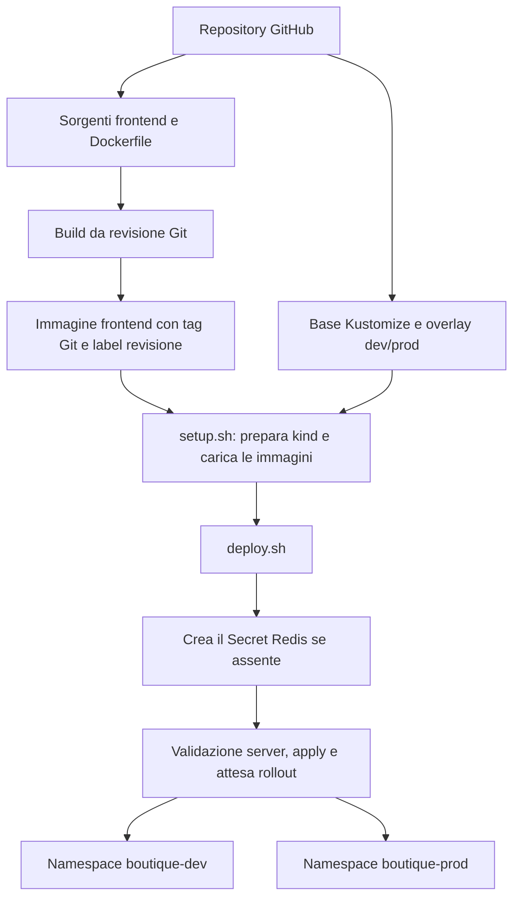
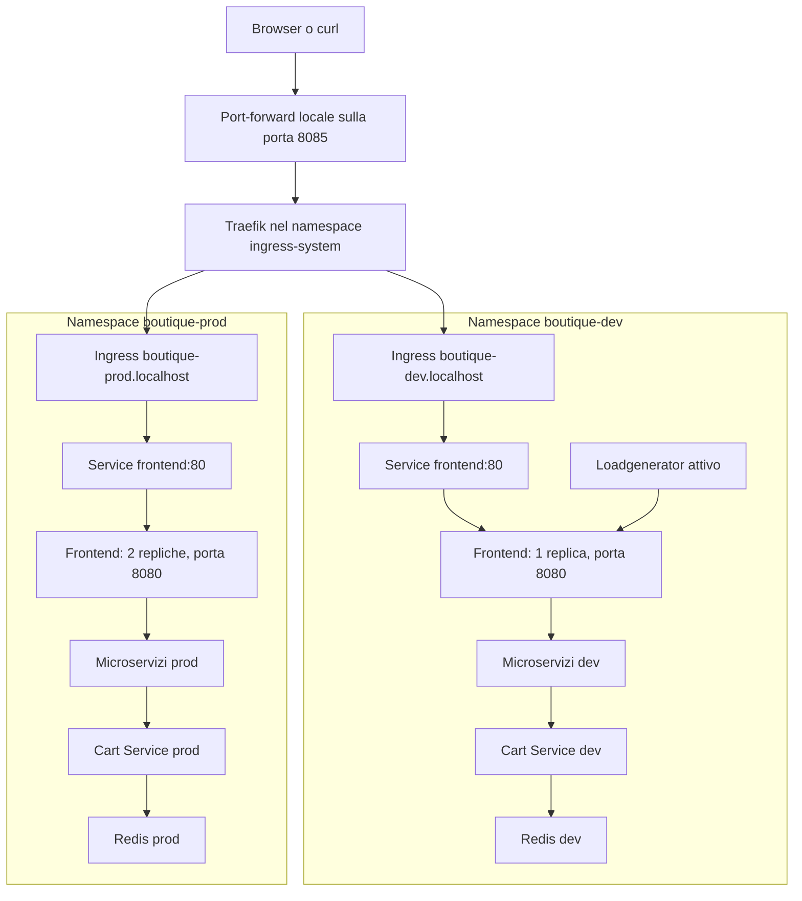
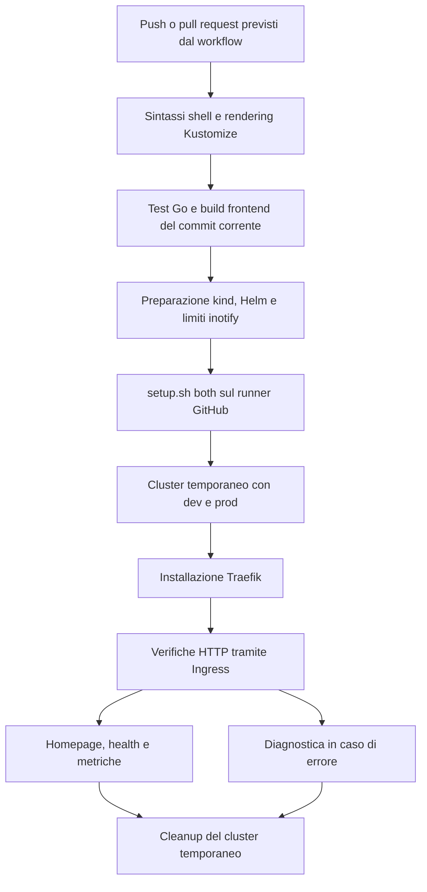
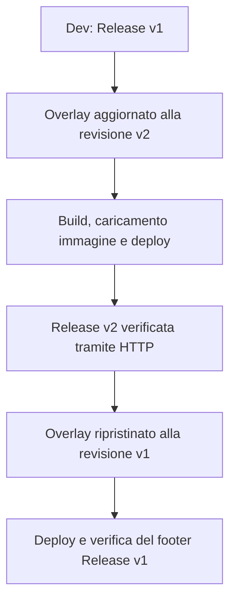

# Mappa del progetto — Kiratech L2 Challenge

Il laboratorio distribuisce Online Boutique su Kubernetes locale con kind.
Il frontend è personalizzato; gli altri servizi usano immagini upstream.
Dev e prod sono ambienti dimostrativi separati tramite namespace.

## 1. Dal repository al deploy

- `validate.sh` verifica il rendering degli overlay.
- `build-frontend.sh` costruisce la revisione richiesta o riutilizza
  un'immagine locale dopo il controllo della label di revisione.
- `setup.sh` crea o riutilizza il cluster e prepara gli ambienti richiesti.
- `deploy.sh` applica i manifest e attende i Deployment.
- Traefik richiede un'installazione Helm separata dal setup locale.
- Il tag Git permette di risalire ai sorgenti; non garantisce build
  identiche byte per byte.

## 2. Accesso e separazione degli ambienti

Il diagramma rappresenta i collegamenti logici: Traefik può raggiungere
direttamente gli endpoint dei pod associati al Service.

Il frontend riceve HTTP e comunica con i servizi applicativi tramite gRPC.
Catalogo, valuta, raccomandazioni, pubblicità, carrello e checkout sono
distribuiti fra i microservizi. Il checkout coordina anche pagamento,
spedizione ed email. Pagamenti e spedizioni sono simulati.

Ogni ambiente possiede i propri servizi e Redis.
Il loadgenerator è disattivato in prod.

Il controller Traefik è stato installato nel cluster di ricostruzione
`kiratech-l2-rebuild`. Il cluster originale `kiratech-l2` è indipendente:
non esiste failover automatico fra i due.

## 3. Pipeline GitHub Actions

Il setup distribuisce le revisioni frontend indicate negli overlay:
possono differire dal commit corrente sottoposto ai test iniziali.

Le verifiche controllano HTTP 200 su `/`, `/_healthz` e `/metrics`
nei due ambienti e la presenza di `frontend_http_requests_total`.
Il percorso completo di acquisto è stato verificato manualmente.

La CI usa un cluster temporaneo sul runner: non aggiorna il laboratorio
locale e non mantiene un ambiente pubblico dopo l'esecuzione.
Il workflow prevede il cleanup anche in caso di errore.

## 4. Configurazione, sicurezza e osservabilità

| Area | Implementazione | Limite |
| --- | --- | --- |
| Configurazione | Overlay dev/prod e ConfigMap del loadgenerator | Separazione logica sullo stesso nodo |
| Credenziali | Secret Redis generati fuori dal repository e conservati se già presenti | Rotazione non implementata |
| Frontend | Utente non-root, filesystem root in sola lettura, capability rimosse, seccomp e token SA non montato | Non costituisce un audit completo di sicurezza |
| Risorse | Requests e limits nei manifest | Nessun autoscaling configurato |
| Probe | Readiness e liveness | La salute del frontend non dimostra il funzionamento dell'intero checkout |
| Log | Log JSON del frontend con informazioni sulle richieste | Nessuna raccolta centralizzata |
| Metriche | Contatore frontend_http_requests_total esposto su /metrics | Per processo, si azzera al riavvio e non aggrega le repliche |
| Redis | Autenticazione e volume emptyDir | Nessuna persistenza, replica o strategia di backup |

## 5. Aggiornamento e troubleshooting

La prova v1 → v2 → v1 è documentata in
[aggiornamento e rollback](update-rollback.md).
Non è stata misurata continuamente la disponibilità durante il rollout.

Sono inoltre documentati:

- [Errore di pull dell'immagine e rollback](incident-image-pull.md).
- [Ricostruzione e problema dei limiti inotify](rebuild-verification.md).

## 6. Krateo e utilizzo AI

Krateo è stato valutato come possibile evoluzione della gestione della
piattaforma, tramite una proposta basata su chart Helm e Composition.
Non è stato installato né verificato con una prova pratica.

- [Valutazione tecnica Krateo](krateo-assessment.md).
- [Utilizzo AI, verifiche e correzioni](ai-usage.md).

L'AI ha supportato codice, configurazioni, documentazione e analisi.
Le evidenze delle esecuzioni e i controlli effettuati sono descritti
nei resoconti; le proposte non eseguite sono distinte dai risultati osservati.

## 7. Confini del laboratorio

- Ogni cluster kind ha un solo nodo.
- Dev e prod condividono il dominio di guasto del nodo.
- Due repliche frontend prod non proteggono dal guasto del nodo.
- I due cluster locali non formano una soluzione ad alta disponibilità.
- L'accesso tramite Traefik è locale, HTTP senza TLS, con port-forward.
- Le immagini frontend vengono caricate in kind senza un registry dedicato.
- Il nome prod identifica un overlay dimostrativo.

## Documentazione operativa

- [Avvio rapido](quickstart.md).
- [Architettura](architecture.md).
- [Installazione e accesso tramite Traefik](../ingress/README.md).
- [Sequenza della demo](demo.md).
